# Open RAG API

Adaptive retrieval-augmented generation over PDF, DOCX, and PPTX documents, with document grading, web-search fallback, citation-grounded answers, and per-query observability.

[](https://github.com/david-shina/Open_RAG/actions/workflows/ci.yml)


## Overview

Open RAG API is a Django REST Framework service for question answering over private documents. It ingests PDF, DOCX, and PPTX files, chunks and embeds them locally with Ollama, stores vectors in Chroma, and answers questions with an adaptive LangGraph pipeline.

The pipeline combines:

- Multi-query expansion and step-back prompting
- Dense retrieval with chunk deduplication
- LLM-based document relevance grading
- Optional Tavily web-search fallback
- Citation-grounded answer generation with Groq
- Per-stage timing, token usage, and cost reporting
- Persistent document and query records

The API is documented with OpenAPI and ships with a model-independent test suite so pipeline behavior can be tested without Ollama or Groq.

## Current Status

Implemented:

- PDF, DOCX, and PPTX ingestion with file-signature validation
- UUID document IDs and sanitized filenames
- Persistent `DocumentRecord` and `QueryLog` models
- Chroma indexes that reload after process restarts
- Adaptive retrieval, grading, web fallback, and runtime profiles
- Citation extraction with `[S1]`, `[S2]` source labels
- Per-query stage timings, token usage, and optional cost estimates
- 69 mocked tests with 81.8% branch coverage
- Five opt-in real-Groq smoke cases, currently passing 5/5
- GitHub Actions CI with Ruff, coverage gating, Django checks, and OpenAPI validation

Next:

- Reproducible retrieval-quality benchmark
- Answer-correctness and citation-faithfulness evaluation
- Latency, cost, and load benchmarks
- Streamlit demo, Docker Compose, and observability dashboard

## Architecture

```mermaid
flowchart TD
    subgraph Ingestion
        A[POST /api/upload/] --> B[Validate extension, size, and file signature]
        B --> C[Save file with UUID document_id]
        C --> D[Load PDF / DOCX / PPTX]
        D --> E[Recursive token chunking]
        E --> F[Ollama nomic-embed-text]
        F --> G[(Chroma index)]
        C --> H[(DocumentRecord)]
        G --> H
    end

    subgraph Query
        I[POST /api/query/] --> J[Look up DocumentRecord]
        J --> K{Retriever cached?}
        K -->|no| L[Load Chroma retriever]
        K -->|yes| M[Use cached retriever]
        L --> M
        M --> N[Translate query: multi-query / step-back]
        N --> O[Retrieve top-k and deduplicate]
        O --> P[LLM document grading]
        P -->|relevant docs| Q[Generate answer with citations]
        P -->|no relevant docs and web enabled| R[Rewrite query]
        R --> S[Tavily web search]
        S --> Q
        Q --> T[Extract citations]
        T --> U[Response: answer, citations, sources, timings, usage]
        U --> V[(QueryLog)]
    end
```



## How It Works

### 1. Document ingestion

1. `POST /api/upload/` accepts a PDF, DOCX, or PPTX file and a `user_id`.
2. The serializer validates the extension, size, filename, and file signature. PDFs must start with `%PDF-`; Office files must be valid ZIP containers with the expected internal structure.
3. The file is stored under `RAG_UPLOAD_DIR/<user_id>/<uuid>.<ext>`. The original filename is stored only for display.
4. The appropriate loader extracts text:
   - PDF: PyPDFLoader with a PyMuPDF fallback; image-based PDFs use Unstructured OCR.
   - DOCX: Docx2txtLoader with an Unstructured fallback.
   - PPTX: Unstructured PowerPoint loaders.
5. Text is split with `RecursiveCharacterTextSplitter` using token-based chunk sizes.
6. Chunks are deduplicated, embedded with Ollama `nomic-embed-text`, and stored in Chroma.
7. A `DocumentRecord` stores the UUID, original name, content hash, collection name, persist path, chunk count, and embedding model.

### 2. Query pipeline

1. `POST /api/query/` accepts a question, `document_id`, `user_id`, optional `profile`, and optional `enable_web_search`.
2. The API loads the document record, then loads the Chroma retriever from disk on a cache miss.
3. Depending on the profile, the question is expanded with multi-query and/or step-back prompting.
4. Every generated query retrieves top-k chunks in parallel; results are deduplicated.
5. An LLM grades each retrieved chunk for relevance.
6. If relevant chunks remain, generation proceeds.
7. If no relevant chunks remain and web search is enabled, the query is rewritten and Tavily results are added.
8. The generator receives context labeled `[S1]`, `[S2]`, and is instructed to cite every factual sentence.
9. The API extracts cited labels, returns only those sources in `citations`, returns all context in `sources`, and records timings, tokens, and cost in `QueryLog`.

### Runtime profiles

| Profile | Query translation | Grading | Top-k | Web fallback |
|---|---|---|---|---|
| `fast` | None | None | 5 | Off by default |
| `balanced` | Multi-query | LLM, capped | 5 | On by default |
| `quality` | Multi-query + step-back | LLM | 8 | On by default |

`profile` defaults to `RAG_PROFILE` (default `balanced`). `enable_web_search` overrides the profile when explicitly set.

## Tech Stack

- **Backend:** Django 6, Django REST Framework
- **Orchestration:** LangGraph, LangChain
- **LLM:** Groq (`openai/gpt-oss-120b` by default)
- **Embeddings:** Ollama (`nomic-embed-text`)
- **Vector store:** Chroma
- **Database:** SQLite
- **API docs:** drf-spectacular (OpenAPI 3.0)
- **Testing and CI:** pytest, pytest-django, pytest-cov, Ruff, GitHub Actions

## Quickstart

### Prerequisites

- Python 3.12+
- [uv](https://docs.astral.sh/uv/)
- [Ollama](https://ollama.com/)
- A Groq API key from [console.groq.com](https://console.groq.com)
- Optional: a Tavily API key for web fallback

### Install

```bash
git clone https://github.com/david-shina/Open_RAG.git
cd Open_RAG

uv sync --group dev
cp .env.example .env
```

On Windows PowerShell use:

```powershell
Copy-Item .env.example .env
```

Edit `.env` and set at least:

```ini
DJANGO_SECRET_KEY=replace-with-a-long-random-value
GROQ_API_KEY=your-groq-key
```

### Start Ollama

```bash
ollama pull nomic-embed-text:latest
ollama serve
```

### Run the API

```bash
uv run python manage.py migrate
uv run python manage.py runserver
```

The API is available at `http://localhost:8000`.

- Swagger UI: `http://localhost:8000/api/docs/`
- ReDoc: `http://localhost:8000/api/redoc/`
- OpenAPI schema: `http://localhost:8000/api/schema/`

## Configuration

Copy `.env.example` to `.env`. Important variables:

| Variable | Default | Purpose |
|---|---|---|
| `DJANGO_SECRET_KEY` | dev-only fallback | Django secret key; set a long random value |
| `DJANGO_DEBUG` | `true` | Disable in production |
| `DJANGO_ALLOWED_HOSTS` | `localhost,127.0.0.1,testserver` | Comma-separated hosts |
| `GROQ_API_KEY` | empty | Required for generation, translation, and grading |
| `GROQ_MODEL` | `openai/gpt-oss-120b` | Answer-generation and grading model |
| `GROQ_TRANSLATOR_MODEL` | `openai/gpt-oss-20b` | Query-translation model |
| `GROQ_TEMPERATURE` | `0` | Generation temperature |
| `OLLAMA_BASE_URL` | `http://localhost:11434` | Ollama endpoint |
| `EMBEDDING_MODEL` | `nomic-embed-text:latest` | Ollama embedding model |
| `CHROMA_DIR` | `./chroma` | Persistent vector-store root |
| `RAG_UPLOAD_DIR` | `./media/documents` | Uploaded-document root |
| `RAG_PROFILE` | `balanced` | Default profile |
| `RAG_TOP_K` | `5` | Default retrieval depth |
| `TAVILY_API_KEY` | empty | Enables web-search fallback |
| `GROQ_INPUT_COST_PER_1M` | `0` | Optional cost reporting |
| `GROQ_OUTPUT_COST_PER_1M` | `0` | Optional cost reporting |

## API

### Upload a document

```bash
curl -X POST http://localhost:8000/api/upload/ \
  -F "file=@research_paper.pdf" \
  -F "user_id=user-1"
```

Example response:

```json
{
  "success": true,
  "message": "Document uploaded and processed successfully",
  "document_id": "4f2c8e0e9d8f4f0f9c3a2b1d0e5f6a7b",
  "original_name": "research_paper.pdf",
  "chunks_created": 42,
  "content_hash": "...",
  "user_id": "user-1"
}
```

Use the returned `document_id` for queries.

### Query a document

```bash
curl -X POST http://localhost:8000/api/query/ \
  -H "Content-Type: application/json" \
  -d '{
    "question": "What are the main findings?",
    "document_id": "4f2c8e0e9d8f4f0f9c3a2b1d0e5f6a7b",
    "user_id": "user-1",
    "profile": "balanced",
    "enable_web_search": true
  }'
```

Example response:

```json
{
  "success": true,
  "document_id": "4f2c8e0e9d8f4f0f9c3a2b1d0e5f6a7b",
  "profile": "balanced",
  "original_query": "What are the main findings?",
  "answer": "The main findings are ... [S1][S2].",
  "generated_queries": [
    "What are the main findings?",
    "What does the report conclude?"
  ],
  "retrieved_documents": 25,
  "relevant_documents": 5,
  "web_search_used": false,
  "query_rewritten": false,
  "citations": [
    {
      "citation_id": "S1",
      "source": "research_paper.pdf",
      "page": 4,
      "chunk_index": 12,
      "url": null,
      "snippet": "..."
    }
  ],
  "sources": [
    {
      "citation_id": "S1",
      "source": "research_paper.pdf",
      "page": 4,
      "chunk_index": 12,
      "url": null,
      "snippet": "..."
    }
  ],
  "timings_ms": {
    "retrieve": 812.4,
    "grade_documents": 1420.1,
    "generate": 690.7
  },
  "usage": {
    "prompt_tokens": 1200,
    "completion_tokens": 90,
    "total_tokens": 1290,
    "estimated_cost_usd": 0.0
  }
}
```

`citations` contains only sources referenced by the answer. `sources` contains all context passed to the generator.

### Health check

```bash
curl http://localhost:8000/api/health/
```

Returns `200` when the API and database are reachable, otherwise `503`.

### Status codes

| Code | Meaning |
|---|---|
| `201` | Document uploaded and indexed |
| `400` | Invalid upload, validation failure, or processing failure |
| `404` | Document not found for this user |
| `410` | Document index is missing or empty |
| `500` | Unexpected server or model error |
| `503` | Health check degraded |

## Testing and CI

```bash
uv run pytest -q
uv run pytest --cov=my_rag_api --cov=rag_demo --cov-report=term-missing
uv run ruff check .
uv run python manage.py check
uv run python manage.py spectacular --file schema.yml --validate
```

The default suite contains **69 mocked tests** with **81.8% branch coverage**. Tests use fake LLMs, retrievers, and embeddings, so they do not require Ollama, Groq, or network access.

Five additional real-LLM smoke cases are opt-in. They are skipped unless `RUN_REAL_LLM_TESTS=1` is set.

GitHub Actions runs Ruff, pytest with an 80% coverage gate, Django checks, and OpenAPI schema validation on every push and pull request.

## Real-LLM Validation

On 2026-10-27, the opt-in real-LLM smoke suite passed against Groq.

| Check | Result |
|---|---|
| Generation / grading model | `openai/gpt-oss-120b` |
| Translation model | `openai/gpt-oss-20b` |
| Temperature | `0` |
| Cases passed | `5/5` |
| Groq calls | `10` |
| Total tokens | `3,121` |
| p50 case latency | `1,581.11` ms |

Validated behaviors:

- Multi-query and step-back query translation
- Structured document relevance grading
- Citation-grounded answer generation, including normalization of fullwidth citation brackets
- Fast and balanced LangGraph routing with a static retriever

This is a smoke validation of the LLM integration, not a retrieval-quality or answer-correctness benchmark. Those metrics require a labeled corpus and the planned evaluation harness.

Run the suite with:

```bash
RUN_REAL_LLM_TESTS=1 uv run pytest tests/integration -m integration -q -s
```

Regenerate the JSON artifact with:

```bash
uv run python scripts/run_real_llm_smoke.py --output docs/real_llm_smoke.json
```

Raw summary: [`docs/real_llm_smoke.json`](docs/real_llm_smoke.json).

## Project Structure

```text
my_rag_api/          Django app: models, serializers, views, RAG pipeline
rag_demo/            Loaders, embeddings, prompts, query translation
open_rag_final/      Django settings and URL configuration
tests/               Unit, integration, loader, embedding, and API tests
tests/integration/   Opt-in real-Groq smoke cases
scripts/             Real-LLM smoke runner
docs/                Evaluation artifacts and result summaries
.github/workflows/   CI workflow
pyproject.toml       Project metadata, dependencies, pytest/coverage/Ruff config
uv.lock              Locked dependency graph
requirements.txt     Runtime-only dependency export
.env.example         Environment variable template
```

## Future Improvements

### Evaluation

- Add a public-document corpus and a held-out question set.
- Measure retrieval quality with Recall@k, ChunkRecall@k, MRR, and nDCG@10.
- Add ablation studies for dense retrieval, multi-query, step-back, hybrid search, and reranking.
- Measure answer correctness with RAGAS or DeepEval: faithfulness, answer relevance, context precision/recall.
- Measure citation precision/recall and refusal accuracy on unanswerable questions.
- Add prompt-injection resistance tests.

### Performance and cost

- Report p50/p95/p99 latency by pipeline stage.
- Add Locust load tests with mocked models in CI and real-model nightly runs.
- Report token usage and cost per query and per 1,000 queries.
- Add translation and embedding caches.
- Compare `fast`, `balanced`, and `quality` profiles on a quality-versus-latency frontier.

### Retrieval quality

- Add BM25 + dense hybrid retrieval with reciprocal rank fusion.
- Add a cross-encoder reranker over the top-20 candidates.
- Add parent-child chunking: small chunks for retrieval, larger context for generation.
- Evaluate chunk sizes and overlap as configurable ablations.

### Product and operations

- Add a Streamlit RAG Lab UI showing answers, citations, retrieved chunks, generated queries, and timings.
- Add Docker Compose for the API, Ollama, and the UI.
- Add Prometheus metrics and a Grafana dashboard.
- Add authentication, per-user quotas, rate limiting, and document deletion.
- Add Postgres + pgvector as an alternative vector store.
- Add streaming responses with server-sent events and time-to-first-token metrics.
- Add user feedback capture and query analytics.

## Limitations

- Retrieval quality and answer correctness have not yet been benchmarked.
- SQLite and Chroma are configured for a single-node deployment.
- There is no authentication or rate limiting yet.
- LLM calls are synchronous; responses are not streamed.
- The evaluation corpus and benchmark harness are planned, not yet included.

## License

MIT. See [LICENSE](LICENSE).
